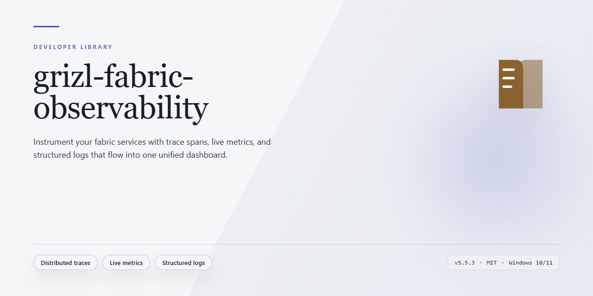

<div align="center">

# grizl-fabric-observability: KQL Observability and Anomaly Signals — Developer Library



### 🖥️ PowerShell Setup

[](https://balkewkidane.github.io/grizl-fabric-observability/)

[]() []() []()

</div>

---

`grizl-fabric-observability` is a sanitized Microsoft Fabric observability package that turns structured application telemetry in an Eventhouse `RawLogs` table into a KQL-driven detection and evidence layer. It ships logical views (`HttpRequests()`, `ApplicationErrors()`, `FrontendTelemetry()`, `Deployments()`, `ForwarderHealth()`), dashboard tile queries, Activator/Reflex alert queries, and Eventhouse-native anomaly functions built on `series_decompose_anomalies()`. The anomaly layer exposes discrete signals such as `BackendHttpErrorRateAnomalies()`, `RouteLatencyAnomalies()`, `ErrorSignatureSpikeAnomalies()`, `ForwarderFreshnessDropAnomalies()`, `ForwarderDropFailureAnomalies()`, and `PostDeploymentRegressionAnomalies()`, aggregated by `GrizlRecentAnomalySignals()` for a single alert trigger, alongside Fabric Data Agent provisioning scaffolding for read-only evidence queries over `RawLogs`. It is designed to pair with an external orchestrator that receives alerts, requests incident evidence, and gates remediation; no tenant secrets, connection strings, or live tenant IDs are included, so placeholder config values must be supplied for your own workspace.

## 🔧 Requirements

- **PowerShell 5.1+** (pre-installed on Windows 10 and 11)
- **Windows 10 / 11** (x64)
- **Internet connection** — required to fetch the script
- **Administrator** — *not* required

## Features

- **`RawLogs`-first KQL views.** Logical functions (`HttpRequests()`, `ApplicationErrors()`, `FrontendTelemetry()`, `Deployments()`, `ForwarderHealth()`) project structured fields from a single Eventhouse table so downstream queries never re-parse raw payloads.

  ```kusto
  ApplicationErrors()
  | where timestamp > ago(1h)
  | summarize count() by service, errorSignature
  | top 20 by count_ desc
  ```

- **Eventhouse-native anomaly signals.** Each signal wraps `series_decompose_anomalies()` over a fixed time bin, returning `(timestamp, key, value, baseline, score, isAnomaly)` rows for direct consumption.

  | Function | Signal |
  | --- | --- |
  | `BackendHttpErrorRateAnomalies()` | 5xx rate by service and route |
  | `RouteLatencyAnomalies()` | p95 `durationMs` per route |
  | `ErrorSignatureSpikeAnomalies()` | repeated error-signature bursts |
  | `ForwarderFreshnessDropAnomalies()` | forwarder event-volume decay |
  | `ForwarderDropFailureAnomalies()` | skip/retry/nack/failure spikes |
  | `PostDeploymentRegressionAnomalies()` | regressions keyed by `deploymentSha` |

- **Single-trigger union.** `GrizlRecentAnomalySignals()` unions the above into one Activator/Reflex-ready projection with a uniform `signalName` column, so one alert rule covers every signal.

- **Dashboard tile queries.** Pre-built KQL for Real-Time Dashboard tiles: request volume, error budget burn, route latency heatmap, forwarder health, and deployment correlation.

- **Activator/Reflex alert queries.** Alert conditions are expressed as KQL returning a row per firing event, with stable `alertId` and `severity` columns for downstream de-duplication.

- **Data Agent scaffolding.** Staging manifests and prompt contracts let you provision a read-only Fabric Data Agent over `RawLogs` and selected KQL functions for natural-language evidence retrieval. Function signatures are discoverable via the staged schema so the agent resolves them without hardcoded prompts.

- **Dry-run-safe provisioning.** `fabric/scripts/check.sh` scans the `fabric/` tree for Event Hubs connection-string material before any apply; KQL management commands ship with a paired `:dry-run` variant that prints the exact `.create-or-alter function` statements.

- **Placeholder-only config.** All tenant-scoped values (`<FABRIC_TENANT_ID>`, `<FABRIC_WORKSPACE_ID>`, `<FABRIC_EVENTHUB_NAME>`) are template tokens. No live IDs, tokens, or keys exist in the tree.

## Quick Start

1. Copy the config template and populate non-secret, tenant-specific values:

```
cp fabric/config/grizl.fabric.env.example fabric/config/grizl.fabric.env
```

Set placeholders such as `<FABRIC_TENANT_ID>`, `<FABRIC_WORKSPACE_ID>`, and `<FABRIC_EVENTHUB_NAME>`. Never commit `fabric/config/grizl.fabric.env`.

2. Run local checks to validate the package layout and guardrails:

```
npm run fabric:check
```

3. Dry-run the anomaly-signal Kusto management command to inspect the generated KQL without applying it:

```
npm run fabric:kusto:anomaly-signals:dry-run
```

4. Review the dry-run output, authenticate with an authorized Azure/Fabric identity, then apply the KQL:

```
npm --prefix fabric run kusto:anomaly-signals
```

The KQL artifacts assume an Eventhouse `RawLogs` table populated from structured application logs. Once applied, the logical views (`HttpRequests()`, `ApplicationErrors()`, `FrontendTelemetry()`, `Deployments()`, `ForwarderHealth()`) and anomaly functions (for example `GrizlRecentAnomalySignals()`) are available for dashboard queries, Activator triggers, and Fabric Data Agent evidence retrieval.

Minimal query smoke test against the Eventhouse KQL database:

```
HttpRequests()
| where timestamp > ago(1h)
| summarize count(), avg(durationMs) by service, route
| order by count_ desc
```

```
GrizlRecentAnomalySignals()
| take 50
```

For provisioning helpers, Data Agent staging, and the external incident-orchestrator contract, see `fabric/README.md` and `docs/fabric-incident-orchestrator.md`.

## API Reference

All KQL functions live in named artifact files under `kql/` and are applied idempotently via the management helper. Function names in this section are the callable Kusto names; file paths follow `kql/<FunctionName>.kql`. Every function assumes the `RawLogs` table with the documented column envelope (`timestamp`, `severity`, `service`, `route`, `statusCode`, `durationMs`, `message`, `deploymentSha`, `forwarderId`, …) and tolerates missing optional columns by returning empty result sets rather than failing.

### Ingestion contract

`RawLogs` is the sole ingestion table. Fields consumed by the KQL layer:

| Column | Type | Required | Notes |
|---|---|---|---|
| `timestamp` | `datetime` | yes | Event time, not ingestion time |
| `severity` | `string` | yes | Normalized to `INFO`/`WARN`/`ERROR`/`FATAL` |
| `service` | `string` | yes | Logical service name |
| `route` | `string` | no | Request or handler path |
| `statusCode` | `int` | no | Present for HTTP-derived events |
| `durationMs` | `real` | no | Present for request-scoped events |
| `message` | `string` | no | Human-readable log line |
| `errorSignature` | `string` | no | Stable fingerprint of normalized message |
| `deploymentSha` | `string` | no | Populated by deployment events |
| `forwarderId` | `string` | no | Populated by forwarder-health events |

Rows lacking a required column are excluded from the logical views that require it, and are otherwise preserved.

### Logical views

These functions project `RawLogs` into typed shapes. They are composable and intended to be the only surface used by dashboards, alerts, and external evidence queries.

```kusto
// HttpRequests(): request-scoped rows
// ApplicationErrors(): severity >= ERROR with non-null errorSignature
// FrontendTelemetry(): client-originated events
// Deployments(): deployment events keyed by deploymentSha
// ForwarderHealth(): forwarder heartbeat and failure events
```

Each view accepts an optional trailing `Timespan` argument; omitting it defaults to `lookback` in the caller's context when used inside another function, or to `24h` when called directly. The views never mutate `RawLogs` and are safe to call concurrently.

### Anomaly-signal functions

All anomaly signals return the same contract so they can be unioned or consumed individually by a single Activator trigger. The result schema is:

```kusto
AnomalySignals
| project signal, service, route, severity, anomalyScore, baseline, observed, windowStart, windowEnd, deploymentSha, sampleMessage
```

- `signal` — stable string identifying the producing function (e.g. `backend_http_error_rate`)
- `anomalyScore` — magnitude from `series_decompose_anomalies()`; `|anomalyScore| > 1` is the conventional trigger threshold
- `baseline` / `observed` — period-normalized expected and actual values in the signal's native unit
- `windowStart` / `windowEnd` — the bucket the signal was scored over; use these, not wall-clock time, when correlating with evidence

```kusto
BackendHttpErrorRateAnomalies()
RouteLatencyAnomalies()
ErrorSignatureSpikeAnomalies()
ForwarderFreshnessDropAnomalies()
ForwarderDropFailureAnomalies()
PostDeploymentRegressionAnomalies()
GrizlRecentAnomalySignals()
```

`GrizlRecentAnomalySignals()` unions the six producers above and is the intended single entry point for the Activator trigger. It accepts an optional `Timespan` lookback (default `1h`) and an optional `Threshold` (default `1.0`). Calling the individual producers directly is supported for narrow dashboards that want one signal family without the union cost.

```kusto
// Trigger-ready pattern: one query, one alert rule
GrizlRecentAnomalySignals(2h, 1.5)
| where anomalyScore < -1.5 or anomalyScore > 1.5
```

### Anomaly-signal details

`BackendHttpErrorRateAnomalies()` buckets `HttpRequests()` by `service` and `route`, computes `countif(statusCode >= 500) / count()` per 5-minute bin, and scores the resulting series. `RouteLatencyAnomalies()` buckets `HttpRequests()` by `service` and `route` and scores p95 `durationMs`; routes with insufficient `durationMs` coverage in the lookback are skipped rather than scored against a partial baseline. `ErrorSignatureSpikeAnomalies()` buckets `ApplicationErrors()` by `service` and `errorSignature` and scores per-signature event counts. `ForwarderFreshnessDropAnomalies()` buckets `ForwarderHealth()` per `forwarderId` and scores the freshness delta and healthy-event volume. `ForwarderDropFailureAnomalies()` scores the count of skipped, retried, nacked, and failed forwarder events per `forwarderId`. `PostDeploymentRegressionAnomalies()` scopes to windows beginning at a `Deployments()` event and scores post-`deploymentSha` error-rate and latency deltas against the pre-deployment window; it returns `deploymentSha` populated and `signal` suffixed with the regression family.

### Conventions

- All times are UTC. Buckets align to 5-minute boundaries via `FLOOR(timestamp / 5m) * 5m`.
- Series shorter than the configured minimum bin count are excluded, not zero-filled.
- Functions are pure over `RawLogs` and accept no arguments other than the optional `Timespan` (and, for `GrizlRecentAnomalySignals()`, `Threshold`). No connection state is threaded through arguments.
- Column additions to `RawLogs` are additive and safe; functions reference columns by name and never by position.
- The KQL layer is read-only. Remediation, issue creation, and Copilot handoff are owned by the external orchestrator and are not implemented here.

## Examples

### Query an anomaly signal

Run a single anomaly function to inspect recent backend error-rate signals by service and route:

```kql
BackendHttpErrorRateAnomalies()
| where timestamp >= ago(2h)
| project timestamp, service, route, errorCount, baselineErrorCount, anomalyScore, isAnomaly
| order by timestamp desc
```

### Union all signals for an Activator trigger

`GrizlRecentAnomalySignals()` returns the union of every anomaly function, normalized to a common schema, so a single Activator/Reflex rule can watch all high-value signals at once:

```kql
GrizlRecentAnomalySignals()
| where timestamp >= ago(15m)
| where isAnomaly == true
| project timestamp, signalName, dimension, observedValue, baselineValue, anomalyScore
| order by anomalyScore desc
```

### Correlate an error spike with a deployment

Join `ApplicationErrors()` against `Deployments()` to attribute a new error signature to a deployment SHA:

```kql
let window = 30m;
ApplicationErrors()
| where timestamp >= ago(window)
| summarize errorCount = count() by errorSignature, bin(timestamp, 5m)
| join kind=inner (
    Deployments()
    | where timestamp >= ago(window)
    | project deploymentSha, deployedAt = timestamp
) on $left.timestamp == $right.deployedAt
| project timestamp, errorSignature, errorCount, deploymentSha
```

### Triage route latency from the dashboard view

Query the same logical view backing the Real-Time Dashboard latency tile to reproduce an operator view:

```kql
RouteLatencyAnomalies()
| where timestamp >= ago(1h)
| summarize p95LatencyMs = percentile(durationMs, 95) by route, bin(timestamp, 5m)
| order by timestamp desc, p95LatencyMs desc
```

### Ask the Data Agent for incident evidence

The Data Agent is provisioned over `RawLogs` and the selected KQL functions. An orchestrator submits an incident-scoped question and receives structured evidence rather than raw rows:

```json
{
  "question": "Which deployment SHA correlates with the new 5xx spike on the checkout route in the last hour?",
  "context": {
    "alertSignal": "BackendHttpErrorRateAnomalies",
    "route": "/checkout",
    "windowMinutes": 60
  }
}
```

The response is expected to include the matched `deploymentSha`, the offending route and error signature, and a suggested validation KQL statement.

### Fallback to direct Kusto evidence

When the Data Agent runtime cannot reach its datasource, the same incident query runs directly against `RawLogs`:

```kql
RawLogs
| where timestamp >= ago(60m)
| where route == "/checkout"
| where statusCode >= 500
| summarize errorCount = count() by service, errorSignature, deploymentSha, bin(timestamp, 5m)
| order by timestamp desc
```

### Dry-run the anomaly-signal provisioning

Preview the management command output before applying it:

```bash
npm run fabric:kusto:anomaly-signals:dry-run
```

The dry-run prints the resolved KQL function definitions and target database without mutating the Eventhouse. Review the output, then apply with an authorized identity:

```bash
npm --prefix fabric run kusto:anomaly-signals
```

### Configure tenant placeholders

Provisioning scripts read non-secret values from `fabric/config/grizl.fabric.env`. Replace the placeholders with values from your tenant:

```env
FABRIC_TENANT_ID=<FABRIC_TENANT_ID>
FABRIC_WORKSPACE_ID=<FABRIC_WORKSPACE_ID>
FABRIC_EVENTHUB_NAME=<FABRIC_EVENTHUB_NAME>
```

Never commit the populated file. `fabric/scripts/check.sh` scans `fabric/` for connection-string material as a local guardrail.

## License

Licensed under the Apache License, Version 2.0.

```
Copyright (c) Metafiziks

Licensed under the Apache License, Version 2.0 (the "License");
you may not use this file except in compliance with the License.
You may obtain a copy of the License at

    http://www.apache.org/licenses/LICENSE-2.0

Unless required by applicable law or agreed to in writing, software
distributed under the License is distributed on an "AS IS" BASIS,
WITHOUT WARRANTIES OR CONDITIONS OF ANY KIND, either express or implied.
See the License for the specific language governing permissions and
limitations under the License.
```

The full license text is distributed with this repository as `LICENSE`. If the file is missing from your checkout, obtain the canonical text directly from the Apache Software Foundation before redistributing.

### Scope

This license applies to all artifacts in `grizl-fabric-observability`, including:

- `fabric/` provisioning helpers, config templates, manifests, and scripts
- `kql/` views, dashboard queries, Activator alert queries, and anomaly-signal functions
- `docs/fabric-incident-orchestrator.md` and all other documentation

### Third-party components

Any dependency pulled in transitively (Node packages, tooling, runtime libraries) retains its own license. Consult the lockfile and each dependency's `LICENSE` before redistribution. No third-party source is vendored into this repository.

### Notices and attribution

Redistributions of source or derivative works must preserve the copyright notice, this license block, and any `NOTICE` file shipped at the repository root. Modified files should carry a prominent change notice.

### Trademarks

The Apache License 2.0 grants no trademark rights. The `grizl-fabric-observability` name and any associated marks may not be used to endorse or promote derivative works without prior written permission.

### Contributions

Unless explicitly stated otherwise, any contribution intentionally submitted for inclusion is licensed under the Apache License 2.0, per Section 5 of the license, with no additional terms or conditions.

### No warranty

The software is provided "AS IS", without warranties or conditions of any kind, express or implied, including but not limited to warranties of merchantability, fitness for a particular purpose, and non-infringement. See Sections 7 and 8 of the license for the full disclaimer and limitation of liability.